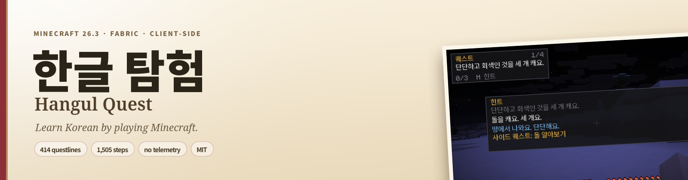
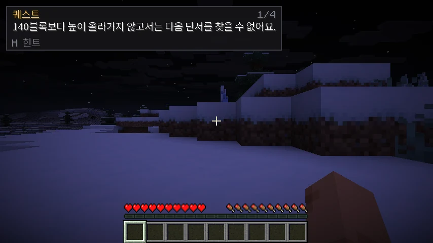
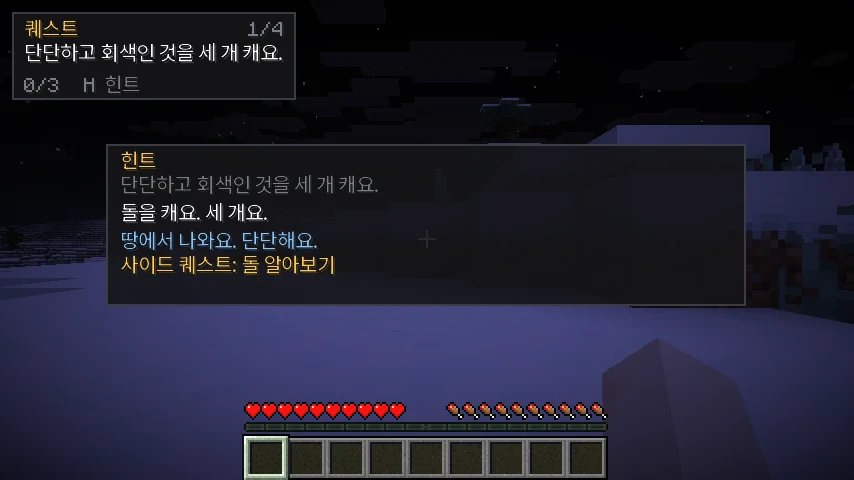
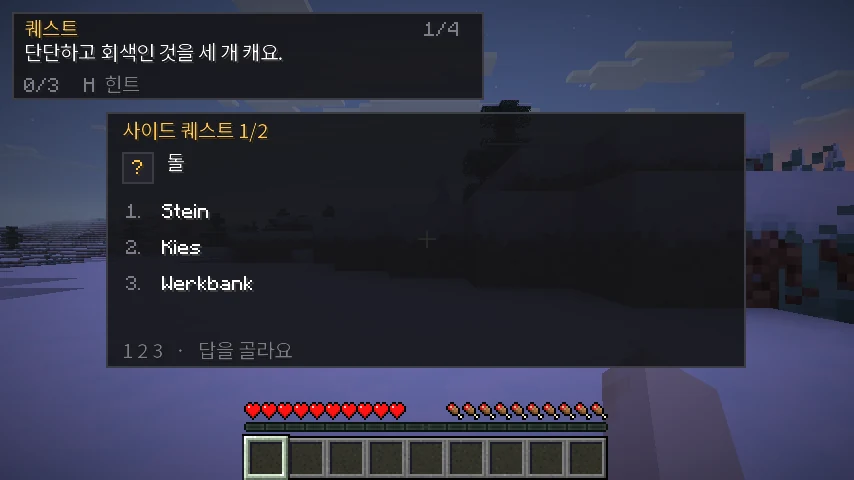
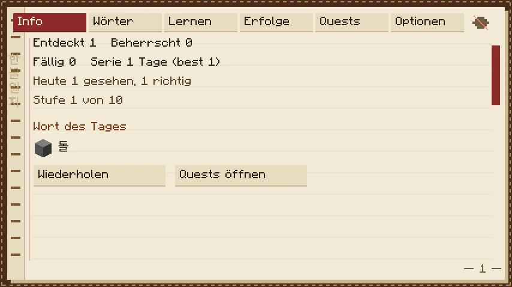
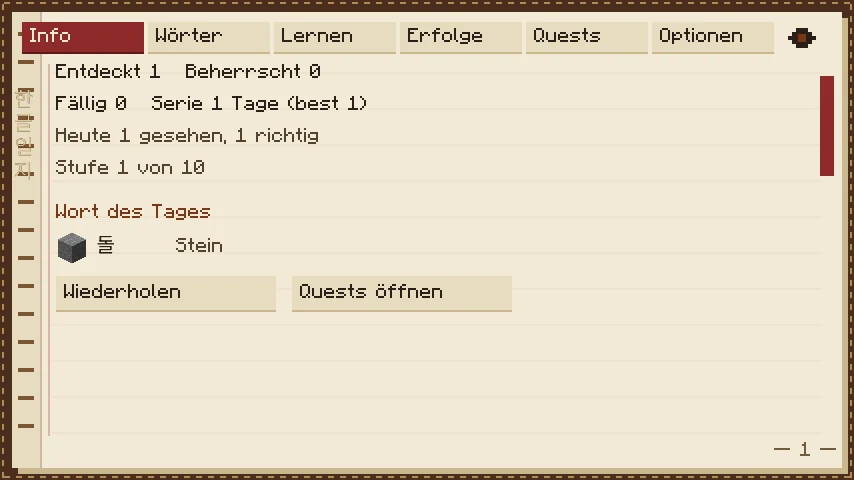
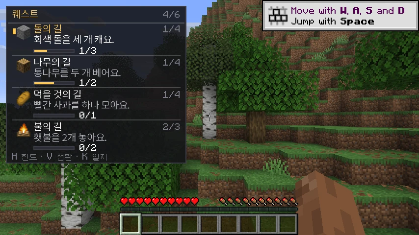
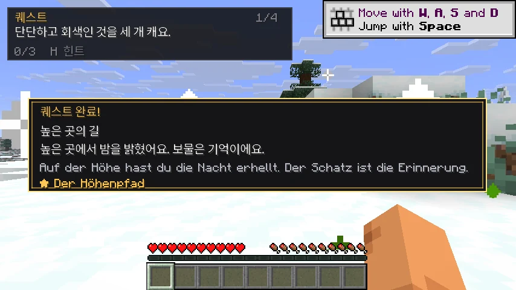
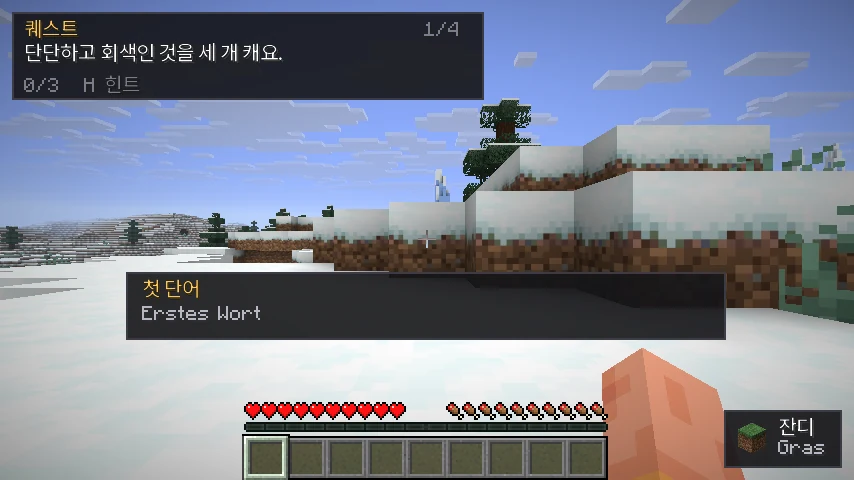
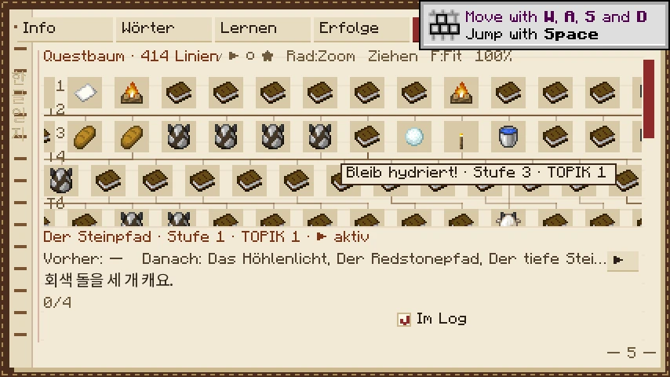

<div align="center">



# 한글 탐험 · Hangul Quest

**Learn Korean by playing Minecraft.** Korean instructions, easier-Korean hints that start a sidequest, and 422 quest trails in a tree that climbs from "break three stone" to harder grammar. Six Korean levels, one instruction ending each, and a real spaced-repetition scheduler behind them.

Client-only Fabric mod. No server component, no packets, no chat, no telemetry.

[**Download**](../../releases) · [**Guide**](https://leks2205.github.io/HangulQuest/) · [Features](#features) · [Install](#install) · [Writing questlines](#writing-your-own-questlines) · [Report a bug](../../issues/new/choose)


[](https://github.com/leks2205/HangulQuest/actions/workflows/ci.yml)

</div>

<p align="center">
  
</p>

---

## Contents

- [About](#about)
- [Features](#features)
- [Screenshots](#screenshots)
- [Install](#install)
- [Keys](#keys)
- [How a quest works](#how-a-quest-works)
- [The journal](#the-journal)
- [Writing your own questlines](#writing-your-own-questlines)
- [Project layout](#project-layout)
- [Building from source](#building-from-source)
- [Compatibility and limits](#compatibility-and-limits)
- [Privacy](#privacy)
- [Contributing](#contributing)
- [Credits](#credits)
- [Legal notes](#legal-notes)
- [License](#license)

## About

Most language-learning mods put vocabulary lists in a book and ask you to read them. Hangul Quest does the opposite: it hides the vocabulary inside the world. A quest is a Korean sentence in the corner of your screen —

```
돌을 세 개 캐요.
```

*"Mine three stone."* — and the world is where you prove you understood it. Finish the step and the next sentence appears; finish the trail and a ritual finale (a torch on a mountain at night, a bell rung at dawn) closes it with a gold card, fireworks and a badge.

When a word blocks you, `H` restates the same task in **simpler Korean**, explains the unknown word in easy Korean, and hands you a two-question **sidequest**. The original quest waits until you have answered both. Nothing is ever translated into a language you can read at a glance — an English, German, Spanish or French line only appears if you switch it on.

Everything happens on your own client. The mod never talks to a server, so it works unchanged in single-player and on any server, with or without other players.

## Features

**Quest trails**
- **422 questlines**, one JSON file each: a tree **22 levels deep**, 1,661 steps in total, 39 roots, branches that merge again before they continue. Over 200 of them were rewritten by hand-briefed batches around one small idea each (the first steps, the village, the kitchen, the smithy, the harbour, animals, colours, mountains); the rebuild goes on.
- **Words come back on purpose.** A trail teaches a few new words and recycles words from earlier trails; a content ratchet in CI keeps task variety and word recycling from getting worse.
- **31 kinds of goal**: break, place, collect, craft, smelt, give, put in, look at, breed, trade, write on a sign, light a candle, hear a bell, wear armour, jump onto snow, sequences ("before", "after") and more. Every condition is spoken in the sentence.
- Each trail is a small Schnitzeljagd — three to five clues that build on each other, then a **ritual finale** that is always completable. No structure, chest, coordinate or rare biome is ever required.
- **A quest log that fills itself.** Up to four quests top-left (three regular ones that fit the start of the game, one that follows where you are), as a short, background-free list: title, current Korean objective, the count right after it (`1/3`) and a status line when a condition is missing. Finishing one brings the next. Tick quests in the journal to choose yourself, or switch *Pick quests automatically* off; `V` cycles the highlight.
- **Only tracked quests advance.** A quest you took out keeps its saved progress but is paused, so nothing completes behind your back.
- Finishing a trail chains onward automatically: the only unlocked child starts, or a card offers up to five follow-ups (`1`–`5`). Leaving a trail pauses it mid-step; coming back resumes that exact step.
- **A readable quest tree.** It shows the trails you can start, the ones in your log and, greyed out, the ones waiting behind them; finished trails fold away.
- **Windows stay until you close them.** Hints, rule cards, culture notes and banners wait for `H`, one window per press, and never change your grade. *Auto-close windows* brings the old timeouts back.

**Hints and sidequests**
- `H` restates the goal in **level-1 Korean** (always simpler than the quest) plus a one-line description of the blocking word, also in easy Korean.
- An unknown word starts a **two-question sidequest** (Korean → meaning, meaning → Korean) and freezes the original step. A wrong answer shows the word card, drops to two options and lets you retry; nothing is penalised.
- Words you already know — a mastered word in the mod, or Lute status 99 — get the hint without a sidequest.
- Quiz cards hide the item icon behind a `?` until you answer, so the picture never gives the answer away.

**Vocabulary**
- About 1,300 concepts: hand-written ones (blocks, tools, food, animals, biomes, verbs, everyday words) with Korean, an easy-Korean description and aliases, plus one entry per rarer object, generated from the game's name files. Glosses live in the language files.
- Every vanilla item, block, entity and biome name, taken from the game's own language files, so the official Korean names are used.
- **Lute import**: drop your Lute export at `config/hangulquest/vocab/lute-vocab.csv` and your own words and learning states become quest vocabulary — read-only, the mod never writes to your file.

**Learning layer**
- **FSRS-6 scheduling** with a retention setting and 5, 10 or 15 new words a day. Four-option cards, self-graded recall, syllable tiles and, for words that are stable, **typing** on a built-in 두벌식 keyboard. Review cards appear in-game only when you are standing still, so nothing interrupts a fight.
- A gentle streak (a weekly goal, two automatic freezes a month), fifteen achievements, a daily **review trail** and graded **stories** that unlock when you know 98% of their words.
- **A grammar ladder**: each Korean level has one instruction ending (`-아/어요`, then `-(으)세요`, then `-아/어야 해요`). A new construction shows a two-line rule card once, and the journal has a grammar book.
- Villagers talk Korean when you sneak and right-click them, with speech-level choices.
- Progress that survives restarts, updates and crashes: per Minecraft account, written atomically, backed up before a migration and kept in daily and weekly copies.

**Journal**
- A journal that is a worn notebook: leather cover, stitched spine, ribbon, cream paper and flat ink text instead of the shadowed Minecraft font.
- Eight tabs: info, words, study, achievements, quests, grammar, books and settings.
- Translations are hidden by default; the eye in the corner reveals them.

**Content as data**
- Questlines are plain JSON under `config/hangulquest/questlines/`, re-read every two seconds: a new file appears in the journal **without restarting the game**, a broken file is logged and ignored, and the shipped version stays active.
- A JSON schema, a template, a scaffolding script (`tools/new_questline.py`), an authoring guide and a validation test guard every change.
- Korean difficulty follows the tree through six levels; the ladder is data (`data/ladder.json`). A new player reads at most one level above the grammar they have met. Hints always stay at the easiest level.

**Presentation**
- Three celebration tiers — step, sidequest, trail — with cards, sounds and client-side particles that the server never sees.
- **English, German, Spanish or French interface** (it follows the game language and falls back to English; *Settings* → *Language* steps through them), and a translation line in quest text, banners and celebrations that stays **off** until you enable it. German is mostly complete; Spanish and French are proofread but cover part of the quest text, and the rest falls back to English. No translation is native-approved yet.
- **Optional voices.** A separate resource pack, "Hangul Quest Voices", adds machine-made clips for words. It is not in the jar, the mod is silent without it, and the clips are not native recordings.
- A bundled Korean font (a Noto Sans CJK KR subset), so Hangul looks the same everywhere instead of falling back to the 6-pixel unifont.

## Screenshots

<table>
  <tr>
    <td></td>
    <td></td>
  </tr>
  <tr>
    <td></td>
    <td></td>
  </tr>
  <tr>
    <td></td>
    <td></td>
  </tr>
  <tr>
    <td></td>
    <td></td>
  </tr>
</table>

## Install

Hangul Quest needs **Minecraft 26.3** (Java Edition), **Fabric Loader 0.19.5 or newer**, **Fabric API 0.162.0+26.3 or newer** and **Java 25**. It is client-side: install it in your own `mods` folder, not on the server.

1. Install [Fabric](https://fabricmc.net/use/installer/) for Minecraft 26.3.
2. Download `hangulquest-<version>.jar` from the [latest release](../../releases/latest) and drop it into `.minecraft/mods/`.
3. Download [Fabric API](https://modrinth.com/mod/fabric-api) for 26.3 and put it in the same folder.
4. Start the game and enter any world — the first questline starts by itself.

Every release ships a `SHA256SUMS` file; on Linux you can verify the download with `sha256sum -c SHA256SUMS`. Release candidates (`3.0.0-rc.N`) are marked as pre-releases and are not what "latest" points to: open the [releases page](../../releases) to find them.

**Updating from 2.x:** your progress is converted and backed up the first time you start 3.0, and the old file is kept untouched. The CHANGELOG has the details and how to roll back.

**You need to be able to read Hangul (the Korean alphabet) first.** Hangul Quest teaches words and grammar, not the alphabet, and most people learn Hangul in a few hours. The first time you join a world, a short welcome screen asks whether you can read it and, if not, points to free lessons (open it again any time from the journal's Info tab: *About reading Hangul*):

- [How to Study Korean, Unit 0](https://www.howtostudykorean.com/unit0/) (English)
- [KoreanClass101: Learn the Korean Alphabet](https://www.koreanclass101.com/korean-alphabet) (English)
- [Ryan Estrada: Learn to Read Korean in 15 Minutes](https://www.ryanestrada.com/learntoreadkoreanin15minutes/) (English, comic)
- [Koreanischkurs: Einführung in Hangeul](https://koreanischkurs.com/sprache/grundlagen/koreanisches-alphabet-lernen/) (Deutsch)

## Keys

All keys can be changed in **Options → Controls → Key Binds → 한글 탐험**.

| Key | Action |
|---|---|
| `K` | Open the journal |
| `H` | Close the top window, or show the hint (and start the sidequest if the word is new) |
| `J` | Review due words now |
| `R` | Answer a waiting review prompt |
| `F8` | Toggle the HUD |
| `V` | Cycle the highlighted quest in the log |
| `1`–`4`, `1`–`5` | Answer in a quiz or sidequest, pick the next trail |

## How a quest works

1. **Clue.** The quest log shows the objective of every quest you are tracking — one Korean sentence each. Every condition is spoken inside the sentence — `해변에서 모닥불을 놓아요.`, "place a campfire *on the beach*" — so text and check can never disagree.
2. **Do it.** The mod verifies the goal locally: blocks broken or placed, items gained or eaten, a block or mob looked at long enough, a biome, a dimension, an altitude, a right-click, an interaction. 31 goal types, 11 condition types, nothing that needs the server's trust.
3. **Stuck?** `H`. Simpler Korean, the word explained, a sidequest so it sticks.
4. **Done.** A step card names the next clue. The finale ends with a gold card, a fanfare, fireworks and a badge; the next trail starts.
5. **Later.** Due words come back as cards, and the generated review trail turns them into a quest again.

The full model — every goal type, every condition, how the quest log words its status lines, what the tests enforce — is in the **[guide](https://leks2205.github.io/HangulQuest/)**.

## The journal

`K` opens the notebook. It is drawn by the mod, not a vanilla screen: leather cover, sewn spine, cream paper and a flat ink font, so Korean stays readable at small GUI scales.

| Tab | What is in it |
|---|---|
| **Info** | Words discovered and mastered, due today, streak, level, word of the day, "About reading Hangul" |
| **Words** | Your dictionary: Korean, the translation, status, and where the word came from (curated, vanilla, Lute) |
| **Study** | Cards for due words, with the review trail as a shortcut |
| **Achievements** | Fifteen achievements with progress |
| **Quests** | The trail tree and a detail card with the **In log** checkbox: ticked quests appear on the HUD and advance, unticked ones wait |
| **Grammar** | The constructions you have met, with their rule cards |
| **Books** | Graded stories and culture notes |
| **Settings** | Language, HUD, auto-close windows, automatic quests, translations in quests, new words per day, retention, sound and the quest folder |

## Writing your own questlines

A questline is one JSON file. No Java, no rebuild:

```json
{
  "schema": 1,
  "id": "steinpfad",
  "titleKo": "돌의 길",
  "titleDe": "Der Steinpfad",
  "topic": "돌",
  "tier": 1,
  "order": 10,
  "koreanLevel": 1,
  "concepts": ["stone", "cobblestone", "coal", "torch"],
  "requires": { "minWordsKnown": 0, "dimension": "minecraft:overworld" },
  "steps": [
    {
      "id": "s1",
      "teach": ["stone"],
      "goal": { "type": "BREAK_BLOCK", "block": "minecraft:stone", "count": 3 },
      "clue": { "ko": "회색 돌을 세 개 캐요.", "de": "Baue drei harte, graue Dinge ab." },
      "hint": { "ko": "돌을 캐요. 세 개요.", "de": "Baue Stein ab, drei Stück." }
    }
  ],
  "finale": {
    "step": {
      "id": "finale",
      "teach": ["torch"],
      "goal": { "type": "PLACE_BLOCK", "block": "minecraft:torch", "count": 1 },
      "conditions": [{ "type": "TIME", "phase": "NIGHT" }]
    },
    "textKo": "어두운 곳에서 빛을 만들었어요.",
    "textDe": "Du hast im Dunkeln Licht gemacht."
  },
  "reward": { "badge": "steinpfad", "words": ["stone", "torch"] }
}
```

- Drop the file into `config/hangulquest/questlines/`. The folder is created on first start and already holds every shipped trail plus `_template.json`. A new file appears in the journal within two seconds; add `"override": true` with an existing `id` to replace a shipped trail.
- `clue` and `hint` are optional — without them the Korean sentence is generated from the goal, with the right particles, counters and time prefixes.
- Korean fields must be Hangul-only. The validator rejects Latin letters, romanisation and emoji.
- Run `./gradlew test` after editing shipped content: it loads every file, checks the tree for dead ends, verifies that `koreanLevel` matches the depth band, and that every condition is spoken in the sentence.

```bash
python3 tools/new_questline.py meinpfad --words stone,dirt --tier 1 \
  --title-ko "나의 길" --title-de "Mein Pfad"
```

References: [`docs/questline.schema.json`](docs/questline.schema.json), the [authoring guide](docs/questlines.md), the [attribute reference](docs/questline-attributes.md) and the [guide's chapter on writing](https://leks2205.github.io/HangulQuest/questlines.html).

## Project layout

| Path | What's in it |
|---|---|
| `src/main/java/…/quest` | Engine facade, goal and condition registries, loader, validator, sentence builder, Korean grammar and morphology, adaptive trail |
| `src/main/java/…/learn` | Progress store and migrations, FSRS, review log, streak, achievements |
| `src/main/java/…/sense` | World sensors (blocks, items, look, biome, dimension, height) and the safety gate |
| `src/main/java/…/ui` | Quest log HUD, journal screen, celebrations, Korean text drawing |
| `src/main/java/…/data` | Concept catalog, vanilla names, Lute CSV import |
| `src/main/resources/assets/hangulquest/data` | `concepts.json`, `names.json`, the grammar ladder and 422 questline files |
| `docs/` | Authoring guide, attribute reference, JSON schema, screenshots, the mdBook guide, the release checklist |
| `content/` | Content briefs and batches, the Korean line registry and its review status, translation status |
| `tools/` | Questline scaffolding, the Korean linter, review and translation pipelines, the review site, coverage and variety reports, audio pack tools |
| `src/test/java` | Unit tests: engine, grammar, SRS, store and migrations, content validation and content QA; `src/gametest` has the client game test |

## Building from source

You need JDK 25; the wrapper pins Gradle 9.7.1 and Loom 1.18.

```bash
git clone https://github.com/leks2205/HangulQuest.git
cd HangulQuest
./gradlew test          # engine tests plus validation of all 422 questlines
./gradlew build         # jar in build/libs/
./gradlew runClient     # development client
```

To look at the UI without playing, start the dev client with `-Dhangulquest.selftest=true`: it opens a world, shows a hint and the journal, and writes `[selftest]` lines to the log.

Building the guide locally:

```bash
cargo install mdbook --version 0.5.4      # or download the release binary
python3 tools/quest_tree.py               # regenerate the tree report
mdbook build docs/book                    # output in docs/book/book
```

## Compatibility and limits

- Built for exactly **Minecraft 26.3**. Other versions are untested; the mod uses named 26.3 classes and will not load elsewhere without changes.
- **Client-only.** It works in single-player and on servers that do not have it. Installing it on a server does nothing.
- Quest text is always Korean. The interface and the optional translation line follow your language (English, German, Spanish, French) and fall back to English where a language has gaps; translations are drafted by AI and proofread by AI, not yet approved by native speakers; see [CONTRIBUTING.md](CONTRIBUTING.md).
- No romanisation (Hangul is a prerequisite) and no speech recognition. Typing a word is optional; audio needs the separate voices pack.
- **The Korean is checked by a linter and two AI reviewers, not yet by native speakers.** The review site and the CONTRIBUTING guide show how to help.
- Goals are limited to what a client can see. There is no "find this structure" or "open this chest" requirement, which is what keeps every trail finishable.
- Progress lives in `config/hangulquest/progress.json`. It lives in `config/hangulquest/profiles/<account>/`, is backed up before a migration and a corrupt file is renamed rather than overwritten, but it is not synced between machines.

## Privacy

- No telemetry, no analytics, no account, no network requests. The mod talks to nothing.
- What it stores stays in your instance: `config/hangulquest/config.json`, the per-account `progress.json` with its review log, and `vocab/lute-vocab.csv`. The optional research export is a zip you create yourself.
- The mod's log lines contain quest ids and file paths, never chat, player names or server addresses.
- Screenshots in this repository were taken in a clean test world.

## Contributing

Bug reports, questlines and code are welcome. Questline contributions need no Java at all — see [CONTRIBUTING.md](CONTRIBUTING.md) and the [authoring guide](docs/questlines.md). Run `./gradlew test` before opening a pull request; content failures show up there, not in the game.

## Credits

- **[Fabric](https://fabricmc.net/)** and **Fabric API** — the loader and the client hooks the quest engine builds on.
- **Noto Sans CJK KR** (SIL Open Font License 1.1) — the bundled Korean font subset. Details in [NOTICE.md](NOTICE.md).
- **[Lute](https://github.com/LuteOrg/lute-v3)** — the vocabulary import reads Lute's CSV export format; Lute itself is not bundled.
- Vanilla Korean, English and German item, block, entity and biome names come from Minecraft's own language files; the quest text built on them is original.

## Legal notes

- **Unofficial.** Hangul Quest is an independent project. It is not affiliated with, endorsed or sponsored by Mojang Studios or Microsoft.
- **Minecraft** is a trademark of Mojang Synergies AB. The mod contains no Minecraft code or assets; it requires a legitimate copy of the game.
- Some questlines are themed around vanilla **advancements**. Only their names and completion conditions are referenced; no advancement data or assets are redistributed.
- The bundled font is a subset of Noto Sans CJK KR and remains under the SIL Open Font License; the reserved font name is not used.

## License

MIT — see [LICENSE](LICENSE). You may use, change and redistribute the mod and its questlines, including in modpacks.

The name "Hangul Quest", the Korean title 한글 탐험 and the banner are not covered by the licence. If you publish a modified version, please give it a different name.
