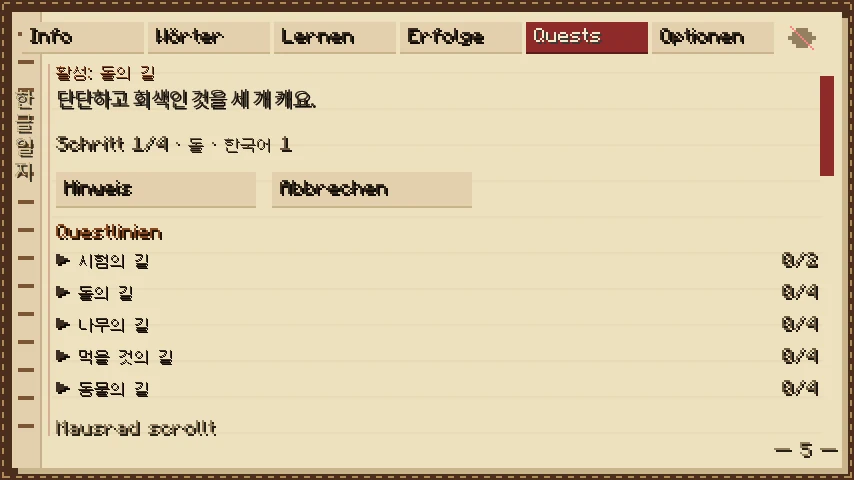
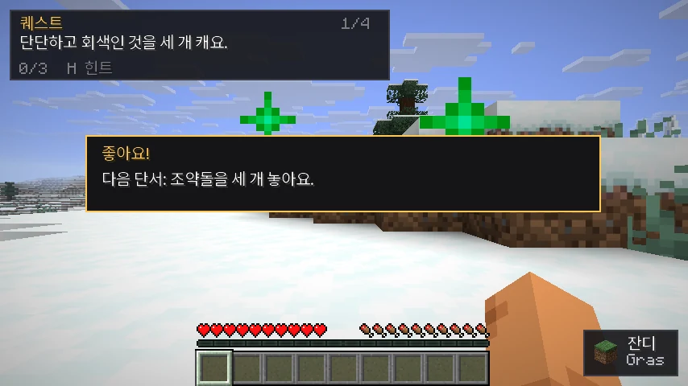
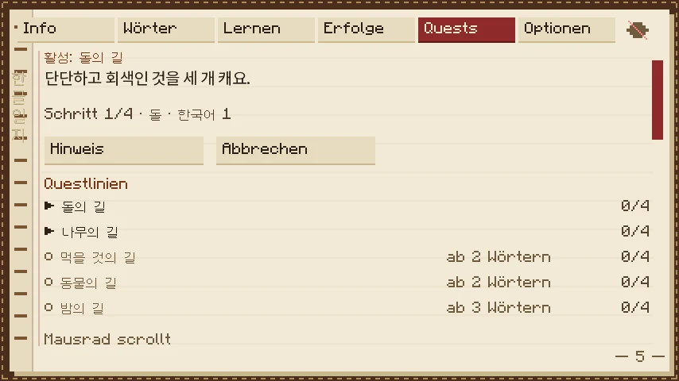
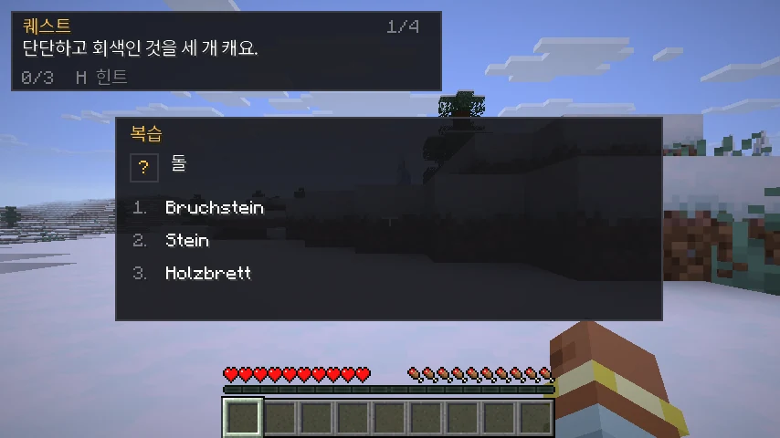
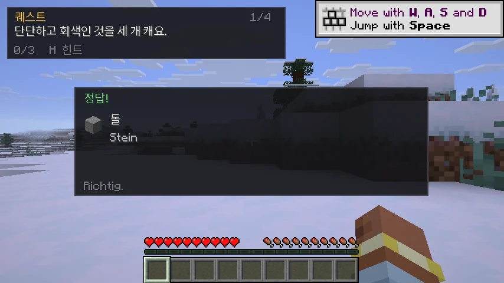

# 한글 탐험 — Hangul Quest

Korean learning for **Minecraft 26.3**, entirely client-side. No server mod, no packets, no chat output.
You get **quests written in Korean**: sentence clues sent you across the world like a Schnitzeljagd, a
hint key that explains things in easier Korean, and a sidequest you have to finish before the original
quest returns.

## Was es macht

- **Questlinien (Schnitzeljagd):** jede Linie ist eine Kette aus 3–4 Hinweisen plus einem Ritual am Ende
  (z. B. nachts auf einem Berg eine Fackel setzen). Der Tracker oben links zeigt den aktuellen
  koreanischen Satz, z. B. `돌을 세 개 캐요.` (Baue drei Stein ab).
- **Hinweis (H):** zeigt denselben Auftrag in **einfacherem Koreanisch** und eine leichte Beschreibung des
  Wortes, das du vermutlich nicht kennst (`돌 = 땅에서 나와요. 단단해요.`). Gleichzeitig startet eine
  **Nebenquest** (zwei Mini-Fragen zum selben Wort). Erst wenn die Nebenquest fertig ist, kommt die
  ursprüngliche Quest zurück. Kennst du das Wort schon (Lute-Status 99), kostet der Hinweis nichts.
- **Wortschatz:** kuratierte Grundwörter (Blöcke, Werkzeuge, Essen, Tiere, Biomes, Verben) plus alle
  Vanilla-Namen, die als Koreanisch/Germanisch-Paar vorliegen, plus deine **Lute-Wörter** (CSV-Import).
- **Weiter nach dem Abschluss:** Ist die nächste Linie frei, startet sie automatisch. Fehlt für sie noch
  eine Voraussetzung, startet stattdessen diese. Gibt es mehrere mögliche Nachfolger, erscheint eine
  Auswahlkarte (``1``–``5``); ohne Auswahl startet nach 60 s die erste.
- **Großer Questbaum:** 414 Linien in bis zu achtzehn Ebenen. Acht Grundlinien, acht Fortsetzungen, dann
  Zweige und Mehrfach-Linien (bis zu drei Voraussetzungen) bis zu den TOPIK-6-Kronen auf Ebene 18. Gesperrte Linien zeigen im Journal, worauf sie warten ("nach …"); die Reihenfolge ist fest
  (`order`), damit die Einsteigerlinie zuerst startet.
- **Deutsch nur auf Wunsch:** Questtexte sind standardmäßig rein koreanisch. Im Journal unter
  Optionen schaltet „Deutsch in Quests" die deutsche Zeile in Questkarten, Bannern und Feiern dazu.
- **Bedingungen im Satz:** Zeit, Wetter, Höhe, Biom, Dimension und Nähe zu Wesen/Blöcken stehen im
  koreanischen Satz — „해변에서 모닥불을 놓아요." statt nur „모닥불을 놓아요.". Tiefe Ziele sagen
  „땅 아래로 내려가요." statt fälschlich „높은 곳으로".
- **Steigendes Koreanisch:** jede Ebene spricht schwieriger — höflich, Pflicht (`-아/어야 해요`),
  nachdrücklich (`-아/어야만 해요`), doppelte Verneinung (`-지 않으면 안 돼요`), literarisch
  (`-지 않고서는 … 수 없어요`). Ab Ebene 5 bleibt es literarisch; der Hint bleibt auf Stufe 1.

- **Wiederholung:** Karteikarten im Spiel (nur wenn du sicher stehst) und im Journal; Leitner-Intervalle,
  Serie, Erfolge.
- **Journal (K):** Übersicht, Wörterbuch, Lernen, Erfolge, Quests, Optionen.

Alles ist lokal: kein Netzwerk, keine Telemetrie, keine Serverfunktion. Auf einem Server ohne den Mod
funktioniert es unverändert.

## Installation

1. Fabric Loader ≥ 0.19.5 für Minecraft 26.3, Fabric API ≥ 0.162.0.
2. `hangulquest-1.0.0.jar` nach `.minecraft/mods/` kopieren.
3. Spiel starten. Im Spiel: `K` öffnet das Journal, `H` zeigt den Hinweis.

Die erste Questlinie startet automatisch beim Betreten einer Welt.

## Tasten (änderbar unter Steuerung → 한글 탐험)

| Taste | Funktion |
|---|---|
| `K` | Journal öffnen |
| `H` | Hinweis anzeigen / Nebenquest starten |
| `J` | Jetzt wiederholen |
| `F8` | HUD an/aus |
| `1`–`3` | Antwort in Quiz/Nebenquest |

## Screenshots

Hinweis auf eine unbekannte Vokabel (H) — einfacheres Koreanisch plus leichte Beschreibung:


Die zugehörige Nebenquest; erst danach kommt die ursprüngliche Quest zurück:


## Eigene Questlinien

Alle Questlinien liegen als einzelne JSON-Dateien in
`~/.minecraft/config/hangulquest/questlines/` (beim ersten Start aus dem Mod kopiert).
Der Ordner wird im Spiel alle zwei Sekunden neu gelesen: neue oder geänderte Dateien erscheinen
**ohne Neustart** im Journal und in der Questliste.

- eine Datei pro Linie, entscheidend ist das Feld `"id"`
- gleiche `id` überschreibt die mitgelieferte Linie, neue `id` kommt hinzu
- `_template.json` als Vorlage, `README.md` im Ordner, Schema unter `docs/questline.schema.json`
- kaputte Dateien werden geloggt und ignoriert; die mitgelieferte Version bleibt aktiv
- Voraussetzungen (`requires.completed`), `order` und `koreanLevel` funktionieren wie bei den eingebauten Linien

Eine live hinzugefügte Linie (`시험의 길`) erscheint sofort ganz oben im Journal:



## Belohnungen

Jeder abgeschlossene Schritt bekommt eine kurze Feier (Karte, Ton, Partikel), eine beendete Nebenquest
etwas mehr, und eine komplette Questlinie eine große Feier mit Feuerwerk, Fanfare und dem Badge:




Die Wortkarte beim Anschauen (kompakt, unten rechts):


Questlinien im Journal — Elternlinien zuerst, Fortsetzungen zeigen ihre Voraussetzung:



Tiefe Linien sprechen literarisch:


Das Journal (K) ist ein gealtertes Notizbuch: Lederdeckel mit Naht, helle Papierseite, Lesebändchen
und flache Tinten-Schrift (ohne Minecraft-Schlagschatten, damit sie auf Papier klar bleibt). Jede Questlinie zeigt ihren Fortschritt (`2/4`), und beim Wechsel wird die alte Linie
pausiert und beim Zurückkehren an derselben Stelle fortgesetzt.


Übersetzungen sind **standardmäßig verborgen**; das Auge oben rechts blendet sie ein:


Die Wörter im Journal passen zum Ziel: der Satz nennt immer den Gegenstand, nach dem gefragt wird
(kein „달" beim Fackel-Ziel, kein „밤" beim Bett-Ziel). Prüfen tut das der Validator.

In Quiz und Nebenquest erscheint statt des Gegenstands ein **?**, damit das Icon die Antwort nicht
verrät; erst nach der richtigen Antwort wird es gezeigt:





## Dateien

- Einstellungen: `config/hangulquest/config.json`
- Fortschritt: `config/hangulquest/progress.json` (wird beim Beenden/Verlassen gespeichert, vor Migration
  automatisch gesichert; kaputte Dateien werden umbenannt, nie überschrieben)
- Lute-Import: `config/hangulquest/vocab/lute-vocab.csv` (Format siehe `vocab/README.txt`, wird beim Start
  gelesen; Status 1–5 = Lernen, 99 = bekannt, 0 = ignoriert)

## Questlinien selbst bauen

Questlinien sind reine Daten: `assets/hangulquest/data/questlines/*.json`. Deutschsprachige Anleitung:
`../questlines.md`; die Attribut-Referenz: `../questline-attributes.md`. Ein neues Gerüst
erzeugt:

```bash
python3 tools/new_questline.py meinpfad --words stone,dirt --tier 1 \
  --title-ko "나의 길" --title-de "Mein Pfad"
```

Danach `./gradlew test` (validiert alle Linien) und bauen.

## Bauen

```bash
./gradlew build        # jar in build/libs/
./gradlew test         # reine Logiktests + Content-Validierung
./gradlew runClient    # Entwicklungsclient
```

Java 25, Gradle 9.7.1, Loom 1.18 (siehe `gradle.properties`).

## Schrift

Die mitgelieferte Koreanisch-Schrift ist ein Subset von **Noto Sans CJK KR** (SIL Open Font License 1.1,
siehe `THIRD-PARTY-NOTICES.md`). Ohne sie würde das Spiel auf die Vanilla-Unicode-Fallback-Schrift
zurückfallen; der Mod rendert Koreanisch bewusst mit eigener Schrift, damit HUD, Journal und Quiz gleich
aussehen. Fällt die Schrift aus, bleibt der Inhalt bedienbar und es gibt eine Log-Warnung.

## Grenzen

- Ziel ist genau Minecraft 26.3; kein Versprechen für andere Versionen.
- Keine Aussprache-Audios, keine Romanisierung, keine koreanische Tastatureingabe (alle Antworten sind
  Multiple Choice).
- Der Lute-Import ist nur lesend; der Mod schreibt nie in deine Lute-Datei.


- Attribut-Referenz: [../questline-attributes.md](../questline-attributes.md).
